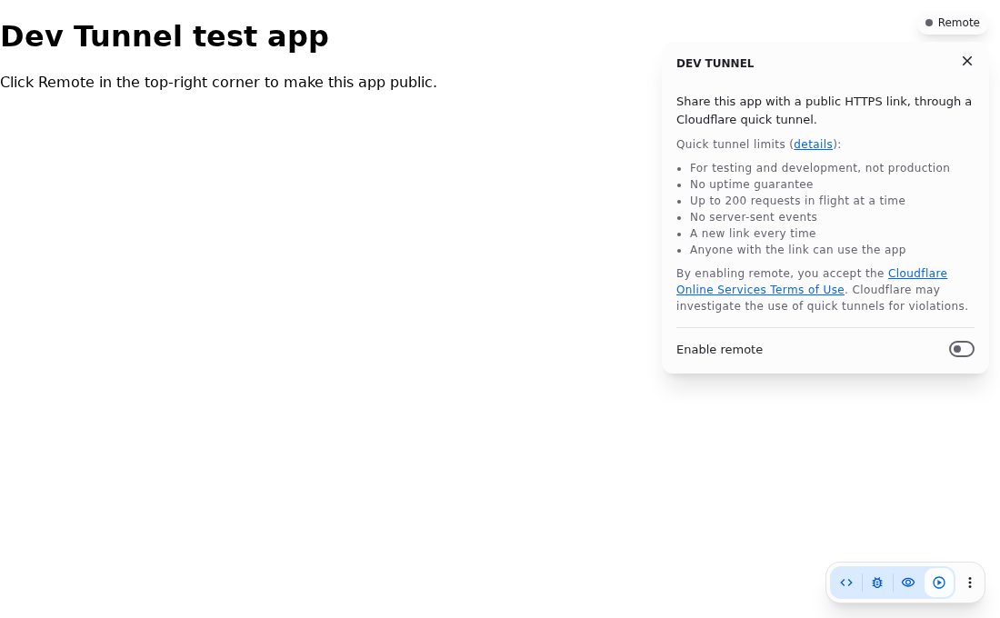
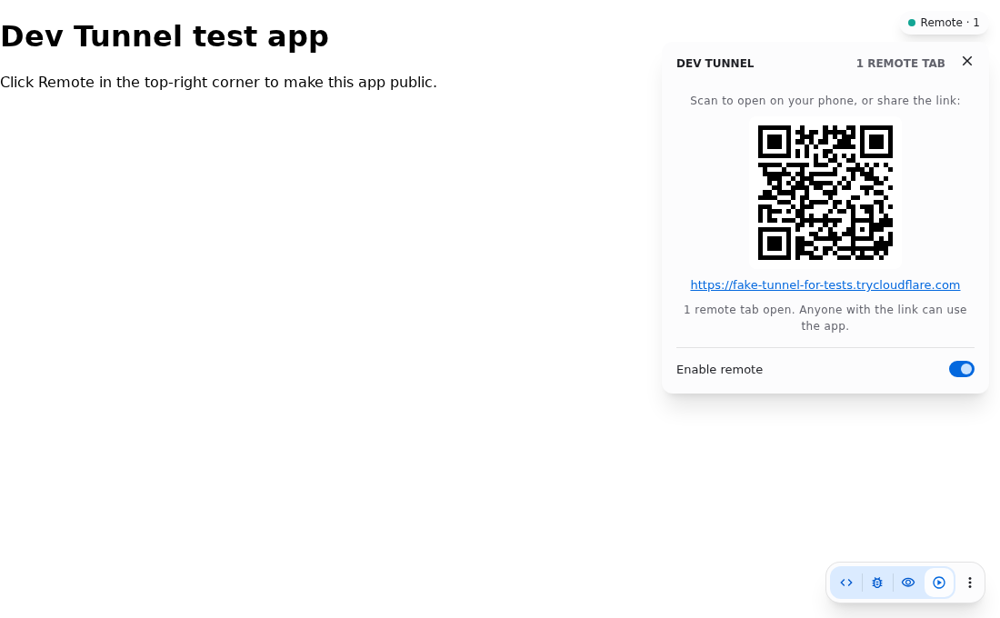
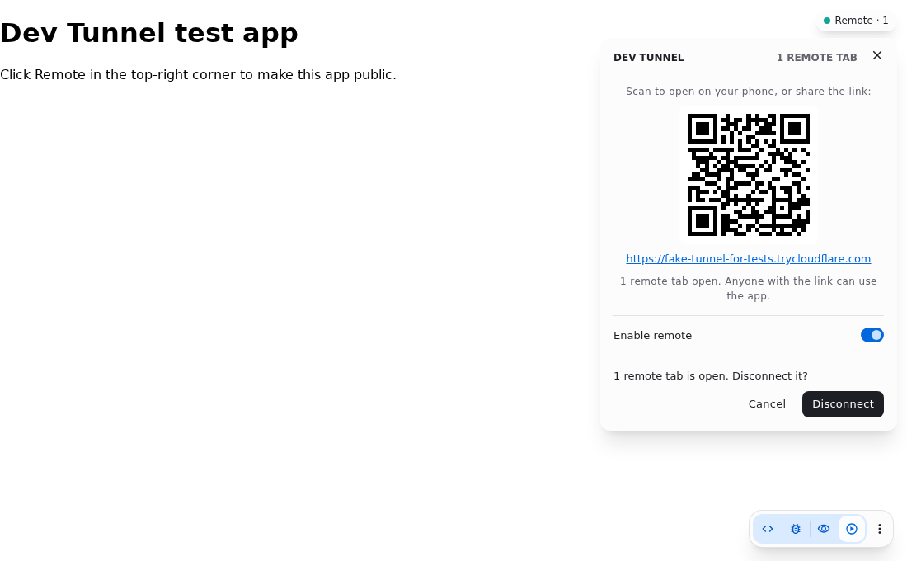

# Dev Tunnel for Vaadin

Show the Vaadin app you're developing to someone else, or open it on your phone, in seconds. In dev mode, pages opened on localhost get a small **Remote** pill in the top-right corner, in [Vaadin Copilot](https://vaadin.com/docs/latest/tools/copilot)'s style. It opens a popover that lists what Cloudflare quick tunnels can and can't do. **Enable remote** opens a [Cloudflare quick tunnel](https://developers.cloudflare.com/cloudflare-one/networks/connectors/cloudflare-tunnel/do-more-with-tunnels/trycloudflare/) to the app and shows a **QR code** and the **link**: an HTTPS URL that works from anywhere, with no account.

While remote is on, the pill reads **Remote · N**: the number of browser tabs open through the link. Turning remote off while tabs are open asks for confirmation first.

| Before enabling | Connected | Turning off |
|---|---|---|
|  |  |  |

Dev Tunnel is a community add-on by [Team Parttio](https://github.com/parttio). It is not part of, or endorsed by, Vaadin Copilot or Cloudflare.

## Use

```xml
<dependency>
    <groupId>org.parttio</groupId>
    <artifactId>dev-tunnel</artifactId>
    <version>0.9.0</version>
    <optional>true</optional>
</dependency>
```

That's all. It registers itself through `META-INF/services`, in Spring Boot and plain Vaadin apps alike, and does nothing in production mode. To keep it out of production builds entirely (it brings ZXing, about 550 KB), add it where you add `vaadin-dev`, for example in your development profile.

The first time remote is enabled, the popover says it's downloading cloudflared (about 40 MB) from Cloudflare's GitHub releases. The download is checked against the SHA-256 that Cloudflare publishes and cached in `~/.cache/dev-tunnel`. After that, it only says it's starting the tunnel.

### Compatibility

- Vaadin **25.3**, in dev mode, with Vaadin Copilot (it comes with `vaadin-dev`). Java 21.
- The pill is rendered inside Copilot's shadow root and uses Copilot's event bus and toggle button, so that it looks
  and feels like Copilot. None of these are public Copilot API. The browser test (`mvn verify -Pit`) checks them
  against the Copilot version in use, and the pill falls back to plain checkboxes when the toggle button is missing.
  If Copilot isn't on the page, the browser console says so.
- macOS (Apple silicon and Intel), Linux (x86-64 and ARM64) and Windows (x86-64).

### Settings (system properties)

| Property | Default | |
|---|---|---|
| `dev.tunnel.enabled` | `true` | `false` turns Dev Tunnel off |
| `dev.tunnel.cloudflared` | | Path to a cloudflared to use, for machines that can't download it. Otherwise a `cloudflared` on the `PATH`, then the cached download. |

The download uses the JVM's proxy settings (`https.proxyHost`, `https.proxyPort`, or `-Djava.net.useSystemProxies=true`).

### Without the pill

```java
try (PublicUrl url = PublicUrl.open(8080)) {
    System.out.println(url.url());   // https://some-random-words.trycloudflare.com
}
```

## How it works

- **The pill and popover** (`dev-tunnel.js`, plain JavaScript, no frontend build) are added only to pages opened from this machine, in dev mode.
- **The server side** is a `DevToolsMessageHandler` on Vaadin's dev tools connection, which Vaadin gives only to the local developer.
- **The tunnel** is cloudflared as a child process, `cloudflared tunnel --url http://localhost:<port>`, with the port the browser uses. It stops when remote is turned off, when the app stops or restarts (Spring Boot devtools, hotswap), and when the JVM shuts down. There's one tunnel per JVM.
- **cloudflared** is, in this order, the one set with `dev.tunnel.cloudflared`, a `cloudflared` on the `PATH` (any version), or a download of the pinned release (2026.10.0) from `https://github.com/cloudflare/cloudflared/releases/download/2026.10.0/cloudflared-<os>-<arch>`. The download goes through the JVM's proxy settings and is checked against SHA-256s that are hardcoded in `Cloudflared.java`, copied from the release notes. It's saved in `~/.cache/dev-tunnel/cloudflared-2026.10.0-<os>-<arch>`, and later runs reuse it. There are downloads for macOS on Apple silicon and Intel (the binary is taken from the `.tgz`), Linux on x86-64 and ARM64, and Windows on x86-64. On anything else, such as Windows on ARM, enabling remote fails with a message asking you to install cloudflared on the `PATH`.
- **Remote tabs** are Vaadin UIs whose first request came through the tunnel (it adds `Cf-Connecting-Ip`). A tab stops counting when it's closed or navigated away from. A tab that goes away without telling, such as a phone going to sleep, counts until its session times out.

## Limits and terms

Cloudflare's quick tunnels are for testing and development, with no uptime guarantee, up to 200 requests in flight, no server-sent events, and a new link every time. They're subject to the
[Cloudflare Online Services Terms of Use](https://www.cloudflare.com/website-terms/), and Cloudflare may investigate their use for violations. The popover shows this before remote is turned on, and enabling remote accepts the terms.

## Security

- Anyone with the link can use the app, with the rights of whoever uses it. Turn remote off when you're done.
- Vaadin gives the dev tools (and Copilot) their access token only when the remote address and every `X-Forwarded-For` hop are allowed (`IndexHtmlRequestHandler.isAllowedDevToolsHost`, Flow 25.3). The tunnel adds
  the visitor's address in that header, so visitors through the link don't get the dev tools, Copilot, or the pill.
- If the JVM is killed with `kill -9`, cloudflared keeps running until stopped (`pkill cloudflared`).

## Development

| Command | |
|---|---|
| `mvn` | Runs the test app at http://localhost:8080. Add `-Dspring-boot.run.arguments=--fake-tunnel` to connect without a network. |
| `mvn verify` | Unit tests. |
| `mvn verify -Pit` | Also a browser test with Playwright, against the test app with real Copilot and a fake tunnel. |

## Releasing

Releases go to Maven Central, and Vaadin Directory picks them up from there.
```sh
mvn release:prepare        # sets the release version, commits, tags vX.Y.Z, moves to the next SNAPSHOT
git push --follow-tags     # .github/workflows/release.yml signs, publishes, and creates the GitHub release
mvn release:clean
```

The workflow uses the parttio organization secrets `CENTRAL_USER`, `CENTRAL_TOKEN`, `OSSRH_GPG_SECRET_KEY` and `OSSRH_GPG_SECRET_KEY_PASSWORD`. It stops if the tag doesn't match the version in `pom.xml`, and fails if Maven Central rejects the release.

## License

Copyright 2026 Team Parttio. Apache License 2.0, see [LICENSE](LICENSE).

Third-party software, all Apache License 2.0:
- [ZXing](https://github.com/zxing/zxing) core 3.5.3 (`com.google.zxing:core`), a dependency, for the QR codes.
- [cloudflared](https://github.com/cloudflare/cloudflared) 2026.10.0, Copyright Cloudflare, Inc. Not bundled: it's downloaded at runtime, see [Use](#use).
